# crystalBALL — Database Schema Draft

Status: **draft for discussion**, not yet migrated. Postgres dialect, to be translated into
Alembic migrations once the shape settles. See `requirements.md` for product context.

Conventions used throughout:

- `uuid` primary keys named `id`, generated with `gen_random_uuid()` (pgcrypto / PG13+ builtin).
- `timestamptz` everywhere, never bare `timestamp`.
- `snake_case` table and column names, plural table names.
- Every foreign key is declared, with an explicit `ON DELETE` policy.

---

## Overview

Four clusters: **identity** (users, admin accounts), **questionnaire definition** (a version and
the questions it owns), **responses and reports** (what a user answered and what was generated
from it), and **money** (purchases and the entitlements they grant).

```mermaid
erDiagram
    users {
        uuid id PK
        text name
        text email UK "unique on lower(email)"
        text school
        text google_sub UK
    }

    admin_accounts {
        uuid id PK
        text name
        text email UK "unique on lower(email)"
        text google_sub UK
        array permissions "admin_permission[]"
        uuid created_by FK
        timestamptz deactivated_at
    }

    questionnaires {
        uuid id PK
        text nickname
        text version
        uuid derived_from_id FK "forked from"
        timestamptz published_at "null = draft"
        uuid created_by FK
        uuid published_by FK
    }

    questions {
        uuid id PK
        uuid questionnaire_id FK
        int position
        enum category "interests | strengths | eq"
        enum answer_type
        text prompt
        enum trait "holland_trait, nullable"
        smallint scale_min
        smallint scale_max
        boolean reverse_scored
    }

    question_options {
        uuid id PK
        uuid question_id FK
        enum answer_type FK "pinned to parent question"
        int position
        text label
        smallint score_value
        enum trait
    }

    questionnaire_activations {
        uuid id PK
        uuid questionnaire_id FK
        timestamptz questionnaire_published_at FK "composite, forces published"
        timestamptz activated_at "clock_timestamp()"
        uuid activated_by FK
    }

    questionnaire_responses {
        uuid id PK
        uuid user_id FK
        uuid questionnaire_id FK
        text contact_email "not users.email"
        timestamptz interests_completed_at
        timestamptz strengths_completed_at
        timestamptz eq_completed_at
    }

    response_answers {
        uuid response_id PK, FK
        uuid question_id PK, FK
        uuid questionnaire_id FK
        smallint answer_numeric "scale"
        text answer_text "free_text"
    }

    response_answer_options {
        uuid response_id PK, FK
        uuid question_id PK, FK
        uuid option_id PK, FK
    }

    reports {
        uuid id PK
        uuid response_id FK
        enum tier "free | full"
        text scoring_version
        text model_version
        text input_hash
        jsonb payload
        timestamptz emailed_at
    }

    career_families {
        uuid id PK
        text slug UK
        text name
        text description
        array example_careers
        array holland_code
        boolean is_active
    }

    report_career_families {
        uuid report_id PK, FK
        uuid family_id PK, FK
        int rank
        numeric fit_score
    }

    career_pay {
        uuid id PK
        text normalized_name "lookup key, no FK"
        text region
        int pay_median
        text source "bls_oews | model_research | mock"
        text occupation_code
        date as_of
    }

    career_guidance {
        uuid id PK
        text normalized_name "lookup key, no FK"
        text region
        text study
        text project
        text topic
        text source "authored | model_research"
        date as_of
    }

    discount_codes {
        uuid id PK
        text code UK "unique on upper(code)"
        text stripe_coupon_id
        timestamptz ends_at
    }

    purchases {
        uuid id PK
        uuid user_id FK
        text stripe_payment_intent_id UK
        text stripe_price_id
        int amount_cents
        uuid discount_code_id FK
        timestamptz paid_at
        timestamptz refunded_at
    }

    entitlements {
        uuid id PK
        uuid user_id FK
        enum kind "single_report | window | coaching_session"
        uuid purchase_id FK "xor granted_by"
        uuid granted_by FK
        uuid response_id FK "null = any response"
        timestamptz valid_until
        timestamptz revoked_at
    }

    users ||--o{ questionnaire_responses : starts
    users ||--o{ purchases : makes
    users ||--o{ entitlements : holds

    admin_accounts |o--o{ admin_accounts : creates
    admin_accounts |o--o{ questionnaires : authors
    admin_accounts |o--o{ questions : edits
    admin_accounts |o--o{ questionnaire_activations : activates
    admin_accounts |o--o{ entitlements : comps

    questionnaires |o--o{ questionnaires : "forked into"
    questionnaires ||--o{ questions : owns
    questionnaires ||--o{ questionnaire_responses : "answered as"
    questionnaires ||--o{ questionnaire_activations : "made live by"

    questions ||--o{ question_options : offers
    questions ||--o{ response_answers : "answered by"

    questionnaire_responses ||--o{ response_answers : collects
    questionnaire_responses ||--o{ reports : "scored into"
    questionnaire_responses |o--o{ entitlements : "unlocked by"

    response_answers ||--o{ response_answer_options : selects
    question_options ||--o{ response_answer_options : "chosen in"

    reports ||--o{ report_career_families : ranks
    career_families ||--o{ report_career_families : "ranked in"

    discount_codes |o--o{ purchases : "applied to"
    purchases      |o--o{ entitlements : grants
```



Cardinalities are crow's foot, read outward from the line: the inner character is the minimum
(`o` = zero, `|` = one) and the outer is the maximum (`|` = one, `{` = many). So `||--o{` is "one
to zero-or-more", and `|o--o{` marks the parent side as optional — those are the relationships
whose foreign key is nullable (`created_by`, `derived_from_id`, `discount_code_id`,
`entitlements.purchase_id` / `granted_by` / `response_id`).

`career_pay` and `career_guidance` deliberately have no edges. Careers are model-generated free
text, so both are looked up by normalized name at render time rather than joined — there's nothing
to hold a foreign key to. They're the two unconnected tables, and that's the design rather than an
omission.

Two things the diagram can't show, both of which matter:

- **Several of these edges are composite foreign keys**, not single-column ones. `response_answers`
  reaches `questions` through `(questionnaire_id, question_id)`, and `response_answer_options`
  reaches `question_options` through `(question_id, option_id)`. Those pairs are what make it
  impossible to answer a question from another questionnaire, or pick an option belonging to
  another question. See "What the composite foreign keys buy".
- **Attribute lists are trimmed** to what's useful for orientation — audit columns, timestamps and
  most constraints are omitted. The table definitions below are authoritative.

---

## Enums

```sql
CREATE TYPE question_category AS ENUM ('interests', 'strengths', 'eq');

CREATE TYPE answer_type AS ENUM ('single_choice', 'multi_choice', 'scale', 'free_text');

CREATE TYPE holland_trait AS ENUM (
    'realistic', 'investigative', 'artistic',
    'social', 'enterprising', 'conventional'
);

CREATE TYPE report_tier AS ENUM ('free', 'full');

CREATE TYPE entitlement_kind AS ENUM ('single_report', 'window', 'coaching_session');

CREATE TYPE admin_permission AS ENUM (
    'author_questionnaire',   -- create and edit drafts
    'publish_questionnaire',  -- set published_at on a draft
    'manage_careers',
    'manage_discount_codes',
    'view_user_data',         -- PII: responses, reports, email addresses
    'manage_purchases',       -- comp a paid report, record a refund
    'manage_admins'
);
```

`question_category` doubles as the paywall boundary: `interests` is free, the other two are gated.

On Holland codes — the six *traits* are a closed set, so they're an enum. But a Holland code is an
ordered *combination* of up to three of them (`RIA`, `SEC`, ...), so where one is stored it's an
ordered array rather than a single enum value. Career families are deliberately **not** an enum
(see `career_families` below).

---

## Users

```sql
CREATE TABLE users (
    id            uuid PRIMARY KEY DEFAULT gen_random_uuid(),
    created_at    timestamptz NOT NULL DEFAULT now(),
    name          text        NOT NULL,
    email         text        NOT NULL,
    school        text,
    google_sub    text UNIQUE
);

CREATE UNIQUE INDEX users_email_lower_idx  ON users (lower(email));
CREATE INDEX        users_created_at_idx   ON users (created_at DESC);
```

- Email uniqueness is enforced by the functional unique index on `lower(email)`, so `Sam@x.com`
  and `sam@x.com` cannot both exist as accounts. This is enforced in the database rather than by
  application-side normalization, and needs no extension.
  **Every email lookup must be written `WHERE lower(email) = lower($1)`** — a query against the
  bare column won't use this index, and worse, won't match case-variant rows.
- `google_sub` is Google's stable subject claim, not the email — Google emails can change, `sub`
  can't. Nullable because the flow captures name/email *before* any SSO happens, so a user row
  can exist with no Google identity attached. Logging in later with a matching email should link
  to the existing row rather than create a second one.
- **No `paid_user` boolean.** Access is granted by rows in `entitlements`, which can be scoped to
  one attempt or to a time window — see Payments.
- **`user_id` on a response is `NOT NULL`, deliberately.** The funnel captures name and email
  before the questionnaire starts, and there is no anonymous path. That's a product decision as
  much as a schema one: every completed assessment is a contactable lead the product owners can
  follow up with. Supporting anonymous starts later would mean making `user_id` nullable and
  adding a claim step, so this is a decision worth being explicit about rather than drifting into.

---

## Admin accounts

Internal staff are a **separate table** from customers, not a role flag on `users`. Two reasons:
the customer signup path creates `users` rows freely from the public funnel, so any privilege
carried on that table is one bug away from being self-grantable; and staff authenticate
differently (Google SSO, ideally restricted to the company domain) from customers who may have no
Google identity at all.

```sql
CREATE TABLE admin_accounts (
    id             uuid PRIMARY KEY DEFAULT gen_random_uuid(),
    name           text NOT NULL,
    email          text NOT NULL,
    google_sub     text UNIQUE,
    permissions    admin_permission[] NOT NULL DEFAULT '{}',
    created_at     timestamptz NOT NULL DEFAULT now(),
    created_by     uuid REFERENCES admin_accounts (id) ON DELETE RESTRICT,
    deactivated_at timestamptz
);

CREATE UNIQUE INDEX admin_accounts_email_lower_idx ON admin_accounts (lower(email));
CREATE INDEX        admin_accounts_permissions_idx ON admin_accounts USING gin (permissions);
```

Permissions are an enum array rather than a single role, because the sensitivities genuinely
differ: authoring a draft is routine, publishing changes what every new user sees, `view_user_data`
is PII access, and `manage_purchases` touches money. A `role` enum would force those to be granted
together. Checks read as `'publish_questionnaire' = ANY (permissions)`, and the GIN index makes
"who can publish?" a real query.

Accounts are **deactivated, never deleted** — `deactivated_at`, plus `ON DELETE RESTRICT` on every
audit column below. A departed admin's name has to stay resolvable for the trail to mean anything.

### Enforcement boundary

Worth being blunt, because it's the one place this schema differs from everything else in it:
**permissions are enforced by the application, not the database.** The app connects as a single
role and the database has no idea which admin is behind a request. Passing an actor id into the
write paths makes an action *recorded*, not *authorized*.

So the audit columns below answer "who did this?" and never "was this allowed?" The permission
check has to happen in the admin endpoints, and it's the one part of the admin surface with no
database safety net underneath it.

---

## Questionnaire definition

```sql
CREATE TABLE questionnaires (
    id              uuid PRIMARY KEY DEFAULT gen_random_uuid(),
    nickname        text        NOT NULL,
    version         text        NOT NULL,
    derived_from_id uuid REFERENCES questionnaires (id) ON DELETE SET NULL,
    created_at      timestamptz NOT NULL DEFAULT now(),
    created_by      uuid REFERENCES admin_accounts (id) ON DELETE RESTRICT,
    published_at    timestamptz,
    published_by    uuid REFERENCES admin_accounts (id) ON DELETE RESTRICT,

    UNIQUE (nickname, version),
    UNIQUE (id, published_at),   -- redundant, but needed as a composite FK target
    CONSTRAINT questionnaires_publish_attribution
        CHECK ((published_at IS NULL) = (published_by IS NULL))
);

CREATE TABLE questions (
    id               uuid PRIMARY KEY DEFAULT gen_random_uuid(),
    questionnaire_id uuid NOT NULL REFERENCES questionnaires (id) ON DELETE CASCADE,
    position         int  NOT NULL,

    category       question_category NOT NULL,
    answer_type    answer_type NOT NULL,
    prompt         text NOT NULL,
    help_text      text,
    trait          holland_trait,   -- which trait a scale item loads on; augmenting, nullable

    -- scale questions only
    scale_min      smallint,
    scale_max      smallint,
    reverse_scored boolean NOT NULL DEFAULT false,

    -- multi_choice only
    max_selections smallint,

    created_at     timestamptz NOT NULL DEFAULT now(),
    created_by     uuid REFERENCES admin_accounts (id) ON DELETE RESTRICT,
    updated_at     timestamptz,
    updated_by     uuid REFERENCES admin_accounts (id) ON DELETE RESTRICT,

    CONSTRAINT questions_update_attribution
        CHECK ((updated_at IS NULL) = (updated_by IS NULL)),
    CONSTRAINT questions_scale_bounds CHECK (
        CASE WHEN answer_type = 'scale'
             THEN scale_min IS NOT NULL AND scale_max IS NOT NULL AND scale_max > scale_min
             ELSE scale_min IS NULL AND scale_max IS NULL AND reverse_scored IS FALSE
        END
    ),
    CONSTRAINT questions_max_selections CHECK (
        CASE WHEN answer_type = 'multi_choice'
             THEN max_selections IS NULL OR max_selections > 0
             ELSE max_selections IS NULL
        END
    ),

    UNIQUE (questionnaire_id, position) DEFERRABLE INITIALLY DEFERRED,
    UNIQUE (questionnaire_id, id),   -- redundant, but needed as a composite FK target
    UNIQUE (id, answer_type)         -- likewise
);

CREATE TABLE question_options (
    id          uuid PRIMARY KEY DEFAULT gen_random_uuid(),
    question_id uuid NOT NULL,
    answer_type answer_type NOT NULL,
    position    int  NOT NULL,
    label       text NOT NULL,
    score_value smallint,
    trait       holland_trait,

    UNIQUE (question_id, position) DEFERRABLE INITIALLY DEFERRED,
    UNIQUE (question_id, id),   -- redundant, but needed as a composite FK target

    FOREIGN KEY (question_id, answer_type)
        REFERENCES questions (id, answer_type) ON DELETE CASCADE,
    CONSTRAINT question_options_choice_only
        CHECK (answer_type IN ('single_choice', 'multi_choice'))
);
```

`requirements.md` left `questionSet` as "reference to another table? or just a list of rows" — the answer
is that **a questionnaire version owns its questions outright**. `questions.questionnaire_id` is a
direct parent link, and `position` lives on the question. There is no join table and no sharing of
question rows between versions.

That ownership is what makes version-level immutability actually hold. If versions shared question
rows, editing a question in a draft would silently rewrite what a published version contains —
immutability through the front door, mutation through the back.

`published_at` distinguishes a draft an admin is assembling from one that's ready. Nullable =
draft. Ready, note, rather than live — which is the next section.

### Which version is live

```sql
CREATE TABLE questionnaire_activations (
    id                         uuid PRIMARY KEY DEFAULT gen_random_uuid(),
    questionnaire_id           uuid NOT NULL,
    -- Denormalized and NOT NULL, so the composite foreign key below can only be satisfied by a
    -- questionnaire whose published_at is set. Published rows are immutable, so it can't drift.
    questionnaire_published_at timestamptz NOT NULL,

    activated_at               timestamptz NOT NULL DEFAULT clock_timestamp(),
    activated_by               uuid REFERENCES admin_accounts (id) ON DELETE RESTRICT,

    FOREIGN KEY (questionnaire_id, questionnaire_published_at)
        REFERENCES questionnaires (id, published_at) ON DELETE RESTRICT
);

CREATE INDEX questionnaire_activations_recent_idx
    ON questionnaire_activations (activated_at DESC);
```

**Which questionnaire is live is not a property of a questionnaire.** The obvious design is an
`is_active` flag on `questionnaires`, and it fails twice over. Published rows are immutable, so
the flag would be unwritable at exactly the moment you'd want to set it. And more fundamentally,
activation is deployment state with a different lifecycle than content — conflating them means
publishing and activating stop being separate decisions, and a version can no longer be staged
before it goes live.

So activation is its own append-only table, and **the active questionnaire is simply the most
recent row**. Rolling back is another row rather than an edit, which means "what was live in
March?" is answerable rather than lost.

Two details carry weight:

- **`questionnaire_published_at` is denormalized specifically to be half of a foreign key.** With
  `UNIQUE (id, published_at)` on the parent and the column `NOT NULL` here, activating a draft is
  *unrepresentable* — a draft's `published_at` is null, so no row can satisfy the constraint.
  That's the alternative to a trigger, and it can't be bypassed.
- **`clock_timestamp()`, not `now()`.** `now()` is fixed for the whole transaction, so two
  activations committed together would tie and "most recent" would be ambiguous.

### Attribution

`created_by` / `published_by` on the version, `created_by` / `updated_by` on the question. Both
pairs are checked against their timestamps — `(published_at IS NULL) = (published_by IS NULL)` —
so a version can't be published without recording who did it.

The paired timestamps are set by the application, not by a trigger: `updated_at` alone could be
maintained automatically, but `updated_by` requires the acting admin, which the database doesn't
know (see the enforcement boundary above). Setting one half in a trigger and the other in the app
would be worse than setting both in one place.

Attribution stops at the question. Options are authored and edited as part of their question, and
a separate trail on `question_options` would add rows without adding much that's answerable.

Notably, there's no edit-history table, and the immutability design is why. Draft edits are
scratch work that gets frozen at publish, so the questions worth answering later — who wrote this
version, who approved it going live, what exactly did it contain — are all answerable from the
published rows themselves. If a full change log is ever wanted, it's additive.

Audit columns are nullable so seed data and migrations don't need a synthetic admin row. Anything
created through the admin surface should always populate them.

### Versions are self-contained

A question belongs to exactly one version and has no identity outside it. There is deliberately
**no per-item lineage** tying "this question in v2" to "the question it was reworded from in v1".

Scoring is therefore defined per version: "which questions sum into *realistic*" is a fact about
that instrument, keyed on `questions.id`. Responses collected under v1 and v2 are separate
populations and are not pooled.

That's the more defensible position anyway — if the instrument changed, it changed, and pooling
across a revision is a psychometric claim nobody has verified. Per-item lineage would assert a
continuity that no constraint can check: a "rewording" that quietly turns one item into a
different one looks identical, in the data, to a typo fix. Not asserting it removes the problem
rather than mitigating it.

Lineage is kept at the **version** level instead — `questionnaires.derived_from_id` records which
version a draft was copied from. That's a fact about an operation that either happened or didn't,
so it can't be wrong. It costs one nullable column.

Nothing here is lost work if that judgment changes. Every question row keeps its own full prompt
text, every answer points at the exact version it was given under, and `derived_from_id` plus
`position` makes an item mapping reconstructable by hand later. Item lineage can be added if a
real need for cross-version pooling shows up; it just isn't worth asserting up front.

### Answer types

`answer_type` drives both rendering and scoring. The four cases:

| type | renders as | answer stored in |
| --- | --- | --- |
| `single_choice` | radio group | one row in `response_answer_options` |
| `multi_choice` | checkbox group | N rows in `response_answer_options` |
| `scale` | Likert radio row | `response_answers.answer_numeric` |
| `free_text` | textarea | `response_answers.answer_text` |

`single_choice` and `scale` both render as radios, but they're kept distinct because they score
differently. A `scale` question is a numeric continuum — its value is the number itself, so it
needs no option rows, and `reverse_scored` flips it about the midpoint (standard in EQ
instruments, where a chunk of items are deliberately worded negatively). A `single_choice`
question is categorical: the options aren't a continuum, so each one carries its own
`score_value` and/or `trait`.

`free_text` is a first-class input, not a fallback. The report is generated by an LLM evaluating
the question/answer pairs directly rather than by summing a fixed instrument, so free-text answers
carry as much weight as any other kind — they just aren't *summable*.

### Deterministic scoring is augmenting, not the backbone

`questions.trait`, `question_options.trait`, `question_options.score_value` and `reverse_scored`
exist to compute things deterministically — chiefly a Holland code from the interests section, by
counting or summing per trait rather than writing bespoke code per question.

That output **augments** generation rather than driving it. Computing a Holland code in SQL and
handing it to the model as structured context anchors the report and is one of the few real levers
on output consistency. But it isn't what produces the report, and there's deliberately **no fixed
instrument** behind the strengths or EQ sections — no subscale taxonomy to pick, nothing summing
into a validated score. Those sections are evaluated from their Q&A pairs.

All of these columns are nullable for that reason: a question that only needs to reach the model as
text carries none of them, which is the common case outside the interests section.

The constraints keep the unused columns null per type, so a `scale` question can't accidentally
carry `max_selections` and a `free_text` question can't claim to be reverse-scored. Worth having:
these are exactly the fields an admin UI will get wrong.

`question_options` carries a denormalized `answer_type`, pinned to its question by composite FK
and constrained to the two choice types. Two things follow from that, both enforced rather than
conventional:

- **Options cannot be authored on a `scale` or `free_text` question at all.** There is no valid
  row to insert, so an admin UI bug can't create orphan options that later make a malformed
  answer representable.
- **A question's `answer_type` cannot be changed while options exist.** Flipping `single_choice`
  to `scale` would leave the child rows referencing a key that no longer exists, and the FK has
  no `ON UPDATE CASCADE`, so the update is rejected outright rather than silently stranding them.

### Immutability after publishing

A published questionnaire is **frozen in its entirety** — the row itself, its questions, and their
options. A draft is freely editable in place. The whole rule is "has `published_at` been set?",
and it is enforced by triggers rather than by convention, because "reject this write" isn't
expressible as a constraint.

```sql
-- the questionnaire row itself
CREATE FUNCTION questionnaires_reject_published_change() RETURNS trigger AS $$
BEGIN
    IF OLD.published_at IS NOT NULL THEN
        RAISE EXCEPTION 'questionnaire % is published and is immutable', OLD.id
            USING ERRCODE = 'restrict_violation';
    END IF;

    RETURN CASE TG_OP WHEN 'DELETE' THEN OLD ELSE NEW END;
END;
$$ LANGUAGE plpgsql;

CREATE TRIGGER questionnaires_immutable_after_publish
    BEFORE UPDATE OR DELETE ON questionnaires
    FOR EACH ROW EXECUTE FUNCTION questionnaires_reject_published_change();
```

```sql
-- its questions
CREATE FUNCTION questions_reject_published_change() RETURNS trigger AS $$
DECLARE
    affected uuid[];
BEGIN
    affected := CASE TG_OP
        WHEN 'INSERT' THEN ARRAY[NEW.questionnaire_id]
        WHEN 'DELETE' THEN ARRAY[OLD.questionnaire_id]
        ELSE               ARRAY[OLD.questionnaire_id, NEW.questionnaire_id]
    END;

    IF EXISTS (
        SELECT 1 FROM questionnaires
        WHERE id = ANY (affected) AND published_at IS NOT NULL
    ) THEN
        RAISE EXCEPTION
            'questionnaire is published; copy it into a new draft version to make changes'
            USING ERRCODE = 'restrict_violation';
    END IF;

    RETURN CASE TG_OP WHEN 'DELETE' THEN OLD ELSE NEW END;
END;
$$ LANGUAGE plpgsql;

CREATE TRIGGER questions_immutable_after_publish
    BEFORE INSERT OR UPDATE OR DELETE ON questions
    FOR EACH ROW EXECUTE FUNCTION questions_reject_published_change();
```

```sql
-- and their options, resolved one hop through questions
CREATE FUNCTION question_options_reject_published_change() RETURNS trigger AS $$
DECLARE
    affected uuid[];
BEGIN
    affected := CASE TG_OP
        WHEN 'INSERT' THEN ARRAY[NEW.question_id]
        WHEN 'DELETE' THEN ARRAY[OLD.question_id]
        ELSE               ARRAY[OLD.question_id, NEW.question_id]
    END;

    IF EXISTS (
        SELECT 1
        FROM questions q
        JOIN questionnaires n ON n.id = q.questionnaire_id
        WHERE q.id = ANY (affected) AND n.published_at IS NOT NULL
    ) THEN
        RAISE EXCEPTION
            'questionnaire is published; copy it into a new draft version to make changes'
            USING ERRCODE = 'restrict_violation';
    END IF;

    RETURN CASE TG_OP WHEN 'DELETE' THEN OLD ELSE NEW END;
END;
$$ LANGUAGE plpgsql;

CREATE TRIGGER question_options_immutable_after_publish
    BEFORE INSERT OR UPDATE OR DELETE ON question_options
    FOR EACH ROW EXECUTE FUNCTION question_options_reject_published_change();
```

Notes on the implementation, all three of which are easy to get subtly wrong:

- **`RETURN CASE TG_OP WHEN 'DELETE' THEN OLD ELSE NEW END`** — a `BEFORE DELETE` trigger that
  returns `NEW` (null on delete) silently *cancels* every delete instead of allowing it.
- **The content triggers fire on `INSERT` too.** Blocking only UPDATE and DELETE would still let
  someone append a question to a published questionnaire, which changes it just as much.
- **Publishing is one-way for free.** `SET published_at = now()` is allowed because `OLD` is still
  null at that point; clearing it afterwards is rejected because `OLD` isn't. No extra rule needed.

Draft questionnaires are untouched by all of this — the checks only bite once `published_at` is
set, which is what makes "assemble it freely, then publish" a usable workflow.

### Forking a version

The corresponding write operation: creating a draft copies the questionnaire, its questions, and
their options.

Deliberately written as a function running three ordinary statements in one transaction, **not** as
a single data-modifying CTE. The content triggers above fire `BEFORE INSERT` on `questions` and
query `questionnaires` to check `published_at` — if the questionnaire row were inserted by a
sibling CTE in the same statement, whether the trigger's snapshot sees it depends on command-counter
semantics that would need to be verified empirically. Separate statements make the question moot:
each one's effects are plainly visible to the next.

```sql
CREATE FUNCTION fork_questionnaire(source_id uuid, new_version text, actor_id uuid)
RETURNS uuid AS $$
DECLARE
    draft_id      uuid;
    src_questions int;  new_questions int;
    src_options   int;  new_options   int;
BEGIN
    INSERT INTO questionnaires (nickname, version, derived_from_id, created_by)
    SELECT nickname, new_version, id, actor_id
    FROM questionnaires WHERE id = source_id
    RETURNING id INTO draft_id;

    IF draft_id IS NULL THEN
        RAISE EXCEPTION 'questionnaire % not found', source_id;
    END IF;

    -- Every non-generated column of `questions` must be listed here. See the hazard note below.
    INSERT INTO questions (questionnaire_id, position, category, answer_type, prompt, help_text,
                           trait, scale_min, scale_max, reverse_scored, max_selections, created_by)
    SELECT draft_id, position, category, answer_type, prompt, help_text,
           trait, scale_min, scale_max, reverse_scored, max_selections, actor_id
    FROM questions
    WHERE questionnaire_id = source_id;

    -- Likewise for `question_options`.
    -- Old question -> new question is mapped through position, which identifies a question
    -- within a version by UNIQUE (questionnaire_id, position).
    INSERT INTO question_options (question_id, answer_type, position, label, score_value, trait)
    SELECT new_q.id, o.answer_type, o.position, o.label, o.score_value, o.trait
    FROM question_options o
    JOIN questions old_q ON old_q.id = o.question_id
                        AND old_q.questionnaire_id = source_id
    JOIN questions new_q ON new_q.questionnaire_id = draft_id
                        AND new_q.position = old_q.position;

    SELECT count(*) INTO src_questions FROM questions WHERE questionnaire_id = source_id;
    SELECT count(*) INTO new_questions FROM questions WHERE questionnaire_id = draft_id;

    SELECT count(*) INTO src_options
      FROM question_options o JOIN questions q ON q.id = o.question_id
     WHERE q.questionnaire_id = source_id;
    SELECT count(*) INTO new_options
      FROM question_options o JOIN questions q ON q.id = o.question_id
     WHERE q.questionnaire_id = draft_id;

    IF (new_questions, new_options) IS DISTINCT FROM (src_questions, src_options) THEN
        RAISE EXCEPTION
            'fork of % copied %/% questions/options, expected %/%',
            source_id, new_questions, new_options, src_questions, src_options;
    END IF;

    RETURN draft_id;
END;
$$ LANGUAGE plpgsql;
```

The count assertions turn a partial copy into a loud failure at the moment it happens. The function
runs in the caller's transaction, so a `RAISE` rolls the whole fork back and leaves nothing behind.

#### Maintenance hazard: column drift

**Both `INSERT ... SELECT` statements enumerate their columns explicitly. Adding a column to
`questions` or `question_options` without adding it here is a silent data-loss bug.**

It's worth being precise about why this one deserves a callout while the other failure modes don't.
A partial copy is caught by the assertions. A mis-mapped option is caught the moment anyone looks
at the draft. Column drift produces a copy that is *structurally complete and quietly wrong*: the
missing column falls back to its default, so a forgotten `reverse_scored` means every reverse-keyed
EQ item in the new version scores forwards. Nothing raises. The reports just start being subtly
wrong, months after the change that caused it, and any version forked from that one inherits it.

Two things contain it:

- **A structural-equality test, which is the real mitigation.** Fork a version, then compare every
  column of source and copy except the ones expected to differ (`id`, `questionnaire_id`, and the
  `created_at` / `created_by` / `updated_at` / `updated_by` stamps). Driving the
  comparison off `information_schema.columns` rather than a hand-written column list is what makes
  it catch *future* columns — a hardcoded list in the test rots exactly as fast as the one in the
  function. This is the highest-value test in the project.
- **Generating the column list dynamically inside the function** is the obvious-looking fix and I'd
  avoid it: it would silently start copying columns that should *not* be copied (a future
  `published_at`, an audit stamp), turning a loud omission into a quiet duplication. Explicit lists
  plus a test that polices them is the safer pairing.

Worth a comment on the table definitions too, pointing at this function — the person adding a
column is reading the table, not the fork.

#### Why the blast radius is small

A fork produces a **draft**: nothing references it, no responses point at it, and it can be deleted
freely. A bad fork only matters if someone publishes it, and publish is a separate, deliberate
step. Showing the draft's questions before publishing is what turns "corrupted version history"
into "a draft somebody threw away" — a stronger safeguard than any care taken in the SQL.

Implication for the admin UI: the editing affordance on a *published* questionnaire is
**"create a new draft version from this"**, never "edit". Within a draft, editing is ordinary and
unrestricted — which is what keeps a typo fix from spawning a new version.

---

## Responses and answers

```sql
CREATE TABLE questionnaire_responses (
    id               uuid PRIMARY KEY DEFAULT gen_random_uuid(),
    user_id          uuid NOT NULL REFERENCES users (id)          ON DELETE CASCADE,
    questionnaire_id uuid NOT NULL REFERENCES questionnaires (id) ON DELETE RESTRICT,

    -- Where to send this report. Deliberately not read from `users.email`: signing in
    -- re-points a response at a verified account, and the address the person actually asked
    -- for should not move with it.
    contact_email          text NOT NULL,

    started_at             timestamptz NOT NULL DEFAULT now(),
    interests_completed_at timestamptz,
    strengths_completed_at timestamptz,
    eq_completed_at        timestamptz,

    UNIQUE (id, questionnaire_id)   -- redundant, but needed as a composite FK target
);

CREATE INDEX questionnaire_responses_user_idx
    ON questionnaire_responses (user_id, started_at DESC);
```

One row per attempt. This is the long-lived object: it stays open across the free report, the
Stripe round trip, and the two paid sections.

Only **submitted** answers reach this table — in-progress drafts live in `localStorage` per the
session-recovery decision. The three nullable timestamps record section-level progress, which is
the granularity the server actually needs.

`questionnaire_id` pins which version was answered, so revising a questionnaire never
retroactively changes the meaning of an old response.

```sql
CREATE TABLE response_answers (
    response_id      uuid NOT NULL,
    questionnaire_id uuid NOT NULL,
    question_id      uuid NOT NULL,
    answer_numeric   smallint,
    answer_text      text,
    answered_at      timestamptz NOT NULL DEFAULT now(),

    PRIMARY KEY (response_id, question_id),

    -- the response is real, and questionnaire_id is the one it was started against
    FOREIGN KEY (response_id, questionnaire_id)
        REFERENCES questionnaire_responses (id, questionnaire_id) ON DELETE CASCADE,
    -- ...and the question is actually part of that questionnaire version
    FOREIGN KEY (questionnaire_id, question_id)
        REFERENCES questions (questionnaire_id, id) ON DELETE RESTRICT
);

CREATE TABLE response_answer_options (
    response_id uuid NOT NULL,
    question_id uuid NOT NULL,
    option_id   uuid NOT NULL,

    PRIMARY KEY (response_id, question_id, option_id),
    FOREIGN KEY (response_id, question_id)
        REFERENCES response_answers (response_id, question_id) ON DELETE CASCADE,
    -- the option must belong to the question it is answering
    FOREIGN KEY (question_id, option_id)
        REFERENCES question_options (question_id, id) ON DELETE RESTRICT
);

CREATE INDEX response_answer_options_option_idx
    ON response_answer_options (question_id, option_id);
```

One row per answered question rather than a single JSON blob on the response, because scoring is
inherently per-item: Holland trait totals and EQ subscales are sums over specific question sets,
which stays a query instead of application code. It also makes "which questions actually predict
anything" answerable later without a schema change.

`response_answers` stays the one-row-per-question anchor — it holds `answered_at` and the values
for `scale` and `free_text` questions. Choice selections live in the child table, one row per
selected option, which is what lets `multi_choice` hold several without duplicating the parent.
`single_choice` is just the degenerate case of exactly one child row.

Selecting an option by FK rather than copying its text means scoring reads `score_value` and
`trait` from the catalogue at scoring time, and `ON DELETE RESTRICT` stops an admin deleting an
option that real answers point at. Options should be retired by removing the question from a
questionnaire version, never by deleting the row.

The composite primary key makes resubmission idempotent — a retried submit upserts the parent and
replaces the child rows rather than duplicating.

### What the composite foreign keys buy

Two integrity holes here are closed declaratively rather than left to the application, which is
why `response_answers` carries a redundant `questionnaire_id` and both tables use composite FKs
instead of simple ones:

1. **An option can only answer its own question.** `option_id` alone would let a client submit
   option #4 of an interests question as the answer to an EQ question — user-controlled input
   with no check on it. The FK to `question_options (question_id, id)` makes that unrepresentable.
2. **A response can only answer questions in its own questionnaire version.** `questionnaire_id`
   is denormalized onto the answer, but it can't drift: one FK pins it to the response it belongs
   to, the other pins the question to that version. The second targets
   `questions`'s `UNIQUE (questionnaire_id, id)`, so it costs no extra index.

Both are enforced at write time with no runtime cost beyond the FK lookups.

### What is left to the submit endpoint

One invariant stays unenforceable in SQL: **the stored value has to match the question's
`answer_type`.** `CHECK` constraints see a single row of a single table, and an answer's shape
spans `questions`, `response_answers`, and `response_answer_options`.

In practice this is narrower than it sounds. A `scale` or `free_text` question is *incapable* of
having rows in `question_options` (see Immutability above), so the composite FK leaves nothing for
a stray selection to point at, and a question can't be flipped between the two worlds once options
or answers exist. What remains is the *cardinality* half, which is a row-counting check and
genuinely impossible declaratively:

- a `single_choice` answer having exactly one option row, not zero or three
- a `multi_choice` answer respecting `max_selections`
- `answer_numeric` falling within the question's `scale_min`/`scale_max`

These live in the submit endpoint, deliberately and not in a trigger: "every required question is
answered, correctly" is the *same* check that has to run to set `interests_completed_at`. Splitting
it between a trigger and the endpoint would be worse than keeping it in one place.

The path that would otherwise reopen all of this — an admin changing a question's `answer_type`
after it has been answered — is closed twice over: by the composite FK from `question_options`,
and by the immutability trigger on published questions.

So the endpoint's remaining job is counting, not shape-checking. If a submit passes the
cardinality rules above, the database guarantees the rest.

---

## Careers catalogue

```sql
CREATE TABLE career_families (
    id              uuid PRIMARY KEY DEFAULT gen_random_uuid(),
    slug            text NOT NULL UNIQUE,
    name            text NOT NULL,
    description     text NOT NULL,
    example_careers text[] NOT NULL DEFAULT '{}',
    holland_code    holland_trait[] NOT NULL DEFAULT '{}',
    is_active       boolean NOT NULL DEFAULT true,

    CONSTRAINT career_families_holland_len CHECK (
        array_length(holland_code, 1) IS NULL
        OR array_length(holland_code, 1) BETWEEN 1 AND 3
    )
);

CREATE INDEX career_families_holland_idx ON career_families USING gin (holland_code);
```

**There is no `careers` table.** Individual careers are generated by the model rather than
selected from a catalogue, because enumerating every career that exists isn't practical. What
*is* curated is the family list: a closed, comprehensive vocabulary the model chooses from.

So this table does three jobs at once:

- **The prompt vocabulary.** `name`, `description` and `example_careers` are what gets handed to
  the model. The examples anchor it toward the right kind of career for a family without
  pretending to be exhaustive — which is the whole point of not having a `careers` table.
- **The validation target.** Because families are a closed set, the model's choice is checkable.
  See `report_career_families` below, where that check is a foreign key rather than a hope.
- **The deterministic ranking input.** `holland_code` on the family, plus the GIN index, supports
  ranking families against a computed Holland code
  (`holland_code && ARRAY[...]::holland_trait[]`) without involving the model at all.

`requirements.md` asked whether career family should be an enum — a lookup table is the right call, and
more so now. An enum can carry none of the above, and Postgres enums are awkward to alter.
`is_active` retires a family without deleting it, since historical reports reference it.

For the initial list, an off-the-shelf taxonomy is a better starting point than inventing one —
the National Career Clusters framework (commonly 16 clusters) and O\*NET's job families are the
usual references. Worth checking the current shape of either before seeding.

### Pay figures

`requirements.md` had `min-pay` / `max-pay` on the Careers table. With careers model-generated, they need
a home that isn't the model itself — see below for why. They live in a lookup keyed by career
name, populated from an authoritative dataset now and extensible to model research later:

```sql
CREATE TABLE career_pay (
    id              uuid PRIMARY KEY DEFAULT gen_random_uuid(),
    normalized_name text NOT NULL,
    region          text NOT NULL,   -- 'US' for now; see below
    currency        char(3) NOT NULL,

    pay_low         int,
    pay_median      int,
    pay_high        int,

    source          text NOT NULL,   -- 'bls_oews', 'model_research', 'mock'
    occupation_code text,            -- SOC code, when the source has one
    source_url      text,
    as_of           date NOT NULL,   -- vintage of the underlying data
    fetched_at      timestamptz NOT NULL DEFAULT now(),

    UNIQUE (normalized_name, region, source),
    CONSTRAINT career_pay_source
        CHECK (source IN ('bls_oews', 'model_research', 'mock')),
    CONSTRAINT career_pay_order CHECK (
        (pay_low IS NULL OR pay_median IS NULL OR pay_median >= pay_low)
        AND (pay_median IS NULL OR pay_high IS NULL OR pay_high >= pay_median)
    )
);

CREATE INDEX career_pay_lookup_idx ON career_pay (normalized_name, region);
```

**Why not let the model supply the number.** Two reasons, and the first is a requirement you
already have. Live research is the least reproducible input there is: the same user, same answers,
same prompt version, two weeks apart, gets different figures because the web moved. `input_hash`
would match while the output didn't, and you'd have no way to tell whether the prompt regressed or
the source did — exactly what `scoring_version` and `model_version` exist to prevent, reintroduced
through a side channel. Second, pay is the most quotable number in a report aimed at teenagers, and
freshly-searched figures skew toward job-board estimates that conflate seniority and region.

So: the model names careers, a lookup supplies the number.

**Start with BLS/OEWS** — the wage data behind O\*NET. Free, bulk-downloadable, citable, updated
annually, and it seeds deterministically, which means no network calls in tests.

#### Partial coverage is the steady state

The dataset holds a few hundred standardized occupations; the model names careers in natural
language. Plenty won't match — anything newer or more specific than the taxonomy. **A miss is
normal, not an error.**

**On a miss, omit the figure. Never fabricate one.** Which makes `pay` optional per career in the
report payload, and means the UI has to render a career cleanly without it. Worth building that
way from the start: if the frontend assumes every career has a salary, model research stops being
an upgrade and becomes a prerequisite for shipping.

#### Three choices that keep the upgrade cheap

Adding model research later should be new code, not a migration. Three things here are what make
that true:

- **Keyed on `(normalized_name, region)`, not on `occupation_code`.** The lookup always starts
  from a model-generated *name* under either design. Keying on the SOC code instead would mean
  restructuring the key — and every query using it — the moment a source arrives that has no code.
  This way `occupation_code` is just provenance that happens to be null sometimes.
- **`source` is `text` + `CHECK`, deliberately not an enum.** The column exists to grow, and
  `ALTER TYPE ... ADD VALUE` is the one schema change that's awkward under Alembic: the new value
  can't be used in the same transaction that adds it. Not worth that friction here. This has
  since paid for itself: migration 0003 added `'mock'` for the demo placeholder figures, and it
  was a two-line `DROP CONSTRAINT` / `ADD CONSTRAINT`. Placeholders needed a source value of
  their own precisely *because* provenance is tracked — recording them as `'bls_oews'` would make
  fabricated numbers indistinguishable from real ones, and the precedence rule below prefers
  sourced data wherever both exist.
- **`region` is present from day one** even though it's always `'US'`. Free now; retrofitting it
  changes every row and every cached lookup key.

The upgrade then adds: a cache-miss path that enqueues a research job (on the job queue, which
is planned but not yet built — see `docs/requirements.md`),
the researcher itself, and a precedence rule — authoritative beats researched when both exist.
Existing rows stay valid and keep winning. The lookup query doesn't change shape.

#### Two things to watch

**Normalization stability.** Cached rows are keyed by whatever function turns "Software Engineer"
into a lookup key. Change that function later and every existing row silently orphans — misses
instead of hits, so it fails quietly and expensively rather than loudly. Freeze it, or version it
into the key.

**Feed the data vintage into `scoring_version`.** When two reports quote different salaries, you
want to know whether the model changed or the pay data did. Same reasoning as `model_version`.

### Per-career guidance

```sql
CREATE TABLE career_guidance (
    id              uuid PRIMARY KEY DEFAULT gen_random_uuid(),
    normalized_name text NOT NULL,
    region          text NOT NULL,

    -- Each is optional on its own, but a row with none of them is just noise.
    study           text,
    project         text,
    topic           text,

    source          text NOT NULL,
    as_of           date NOT NULL,
    fetched_at      timestamptz NOT NULL DEFAULT now(),

    UNIQUE (normalized_name, region, source),
    CONSTRAINT career_guidance_source
        CHECK (source IN ('authored', 'model_research')),
    CONSTRAINT career_guidance_not_empty CHECK (
        study IS NOT NULL OR project IS NOT NULL OR topic IS NOT NULL
    )
);

CREATE INDEX career_guidance_lookup_idx ON career_guidance (normalized_name, region);
```

Next steps attached to a *career*, replacing the single trait-derived list the report used to end
with. The difference is specificity: "take a design and technology course, build a bike, learn
basic statics" is a direction someone can act on, where "start a portfolio" is a platitude that
fits every career equally and therefore helps with none.

**Shaped like `career_pay`, for the same reasons.** Careers are model-generated free text, so the
key is `(normalized_name, region)` rather than a foreign key; `source` is `text` + `CHECK` so it
can grow; `region` is present from day one. Everything in "Three choices that keep the upgrade
cheap" above applies here unchanged, including the normalization-stability warning — both tables
are keyed by the same function, so changing it orphans both at once.

Two things differ:

- **`region` matters more here than it does for pay.** Schooling routes are the most
  region-specific advice in the product: "a BTEC then a degree apprenticeship" and "community
  college then transfer" are the same advice in two countries, and neither is portable.
- **`career_guidance_not_empty`.** The three fields are independently optional — plenty of
  careers have a good project suggestion and no distinctive schooling route — but a row with all
  three null is a lookup hit carrying nothing, which is worse than a miss. A miss renders cleanly;
  an empty hit renders an empty section.

Source values are `'authored'` and `'model_research'` rather than pay's dataset names, because
there's no BLS equivalent for advice. `'authored'` is the curated seed content; model research is
the same deferred upgrade, with the same precedence rule — authored beats researched.

---

## Reports

```sql
CREATE TABLE reports (
    id              uuid PRIMARY KEY DEFAULT gen_random_uuid(),
    response_id     uuid NOT NULL REFERENCES questionnaire_responses (id) ON DELETE CASCADE,
    tier            report_tier NOT NULL,
    generated_at    timestamptz NOT NULL DEFAULT now(),
    scoring_version text NOT NULL,
    model_version   text,
    input_hash      text NOT NULL,
    payload         jsonb NOT NULL,
    emailed_at      timestamptz
);

CREATE INDEX reports_response_idx ON reports (response_id, generated_at DESC);
CREATE INDEX reports_input_hash_idx ON reports (input_hash, scoring_version);
```

A response is scored **more than once** — once free from interests alone, once full after payment,
and potentially again if scoring is revised. Every scoring run appends a row; nothing overwrites.
That gives result history the real progression to display, and gives you the ability to re-run
scoring over old responses and diff the output when the consistency work starts.

`payload` holds the whole rendered report — traits, career strengths, ranked career families,
career suggestions with fit scores, challenges, next steps. It's kept as `jsonb` because it's
always read whole (screen, email, PDF) and its shape will churn heavily during design.
Structure worth committing to inside it, so it can be validated and later extracted:

```jsonc
{
  "traits":     { "realistic": 0.42, "investigative": 0.81, ... },
  "strengths":  [ { "name": "...", "evidence": "..." } ],
  "families":   [ { "family_id": "...", "rank": 1, "fit_score": 0.86 } ],
  "careers":    [ { "name": "...",              // model-generated, free text
                    "family_id": "...",         // must exist in career_families
                    "fit_score": 0.86,
                    "rationale": "...",
                    "pay": {                    // OPTIONAL — omitted on a career_pay miss
                      "low": 48000, "median": 71000, "high": 104000,
                      "currency": "USD",
                      "source_url": "...", "as_of": "2025-05-01"
                    } } ],
  "challenges": [ { "title": "...", "detail": "..." } ],   // 5-7 per requirements.md
  "next_steps": [ { "kind": "project|topic|...", "detail": "..." } ]
}
```

Career names are free text because the model generates them; there is no `careers` table to
reference. Every `family_id` appearing here, though, must exist in `career_families` — the
`families` ranking is mirrored into a real table for exactly that reason (below).

`scoring_version` and `model_version` are cheap now and impossible to backfill. Without them you
can't distinguish a broken prompt from an old one when two reports disagree.

### Ranked families are extracted, not left in the payload

```sql
CREATE TABLE report_career_families (
    report_id uuid NOT NULL REFERENCES reports (id)         ON DELETE CASCADE,
    family_id uuid NOT NULL REFERENCES career_families (id) ON DELETE RESTRICT,
    rank      int  NOT NULL,
    fit_score numeric(4,3),

    PRIMARY KEY (report_id, family_id),
    UNIQUE (report_id, rank) DEFERRABLE INITIALLY DEFERRED,
    CONSTRAINT report_career_families_fit_range CHECK (
        fit_score IS NULL OR fit_score BETWEEN 0 AND 1
    )
);

CREATE INDEX report_career_families_family_idx ON report_career_families (family_id);
```

Career *families* are the one part of a report drawn from a closed vocabulary, so they're the one
part worth taking out of `jsonb`. A `family_id` sitting inside `payload` is unenforced — a model
that returns an unknown or malformed id produces a report that looks fine and renders broken. As a
foreign key, that same mistake fails at write time.

It also makes the obvious product questions queryable without scanning jsonb: which families are
recommended most, whether one is never suggested, how rankings shift after a prompt change.

**Write the table first and render `payload.families` from it**, rather than writing both from the
model's output. Two copies written independently drift; one derived from the other can't.

Everything else in the report stays in `payload`. The reasoning there is unchanged — it's read
whole, and its shape will churn. Families are the exception because they're the only part with
referential integrity to enforce.

### `input_hash` and the consistency requirement

A hash of the **normalized question/answer set** the report was generated from — the ordered list
of `(question prompt, answer)` pairs as the LLM saw them, not the raw row ids.

`requirements.md` asks that identical assessment inputs produce similar outputs. Since generation is an
LLM call, that isn't free, and `input_hash` is what makes it addressable at all:

- It makes the requirement **checkable**. Group reports by `(input_hash, scoring_version)` and you
  can see directly how much output varies for identical input — which is otherwise very hard to
  measure after the fact.
- At the strong end it makes consistency **exact**: on a hash hit for the same `scoring_version`,
  serve the existing report instead of regenerating. Identical in, identical out, and it saves the
  model call.

Hash the normalized text rather than ids so that two users who gave the same answers to the same
questions collide even across questionnaire versions where the wording didn't change.

Whether to reuse on a hit or merely measure divergence is a decision for when the generation API
is designed. The column is cheap now and impossible to backfill, which is the only reason it's
here already.

`scoring_version` should fold in the vintage of anything the report draws on besides the model —
the `career_pay` dataset especially. Two reports quoting different salaries for the same career is
otherwise unexplainable: you can't tell whether the prompt changed or the source data refreshed
underneath it.

`emailed_at` records the Resend send. PDFs are rendered on demand from `payload` rather than
stored — no blob storage needed.

### Reconstructing the input

Because published versions are immutable, the exact prompt text and option labels a user saw are
reconstructible from their answer rows forever, including for responses collected under older
versions. That's what makes a faithful Q&A transcript rebuildable at any time — for regenerating a
report, for auditing one, or for computing `input_hash` after the fact.

The immutability machinery in the questionnaire section was built for scoring integrity; this is
the second thing it buys.

---

## Payments

Stripe is the source of truth for money. These tables exist so the app can answer "is this
response paid for?" without a Stripe API call on every page load.

Two separate things, deliberately: `purchases` is the **money event**, `entitlements` is **what the
money bought**. Splitting them is what keeps the pricing model out of the schema.

```sql
CREATE TABLE discount_codes (
    id            uuid PRIMARY KEY DEFAULT gen_random_uuid(),
    code          text NOT NULL,
    stripe_coupon_id text,
    starts_at     timestamptz,
    ends_at       timestamptz,
    max_redemptions int,

    CONSTRAINT discount_codes_window CHECK (ends_at IS NULL OR starts_at IS NULL OR ends_at > starts_at)
);

CREATE UNIQUE INDEX discount_codes_code_upper_idx ON discount_codes (upper(code));
```

Thin by design — Stripe Promotion Codes can own the discount logic entirely. This table is mostly
for admin-side searchability and for validating a code before handing the user to checkout.

**Now implemented.** The Stripe round trip is built, and the table kept its role: Stripe owns
the pricing logic (the Coupon and its rules), and this table owns *which codes the product
accepts* and lets a code be validated before the redirect. `discount_codes.stripe_coupon_id` is
the join — the code is applied to the Checkout Session as `discounts=[{"coupon": ...}]`.

The local `starts_at`/`ends_at` are **enforced**: a code outside its window is refused with a
400, before the visitor reaches Stripe's page. Leaving the columns unenforced while they exist
is the worst of both — it looks like a control that isn't one. `max_redemptions` is **not**
enforced; there is a comment on the lookup saying so.

Same functional-index approach as `users.email`, folded upward instead — redemption must query
`WHERE upper(code) = upper($1)`. The lookup does exactly that, so the index is usable and
`SUMMER20` and `summer20` are the same code.

```sql
CREATE TABLE purchases (
    id                         uuid PRIMARY KEY DEFAULT gen_random_uuid(),
    user_id                    uuid NOT NULL REFERENCES users (id) ON DELETE RESTRICT,
    stripe_checkout_session_id text UNIQUE,
    stripe_payment_intent_id   text UNIQUE,
    stripe_price_id            text,
    amount_cents               int  NOT NULL,
    currency                   char(3) NOT NULL DEFAULT 'usd',
    discount_code_id           uuid REFERENCES discount_codes (id) ON DELETE SET NULL,
    paid_at                    timestamptz,
    refunded_at                timestamptz,
    created_at                 timestamptz NOT NULL DEFAULT now()
);

CREATE INDEX purchases_user_idx ON purchases (user_id, created_at DESC);
```

`stripe_price_id` keeps the tier/SKU definition in Stripe rather than duplicating a product
catalogue locally. Nothing here says what was bought — that's the next table's job.

```sql
CREATE TABLE entitlements (
    id          uuid PRIMARY KEY DEFAULT gen_random_uuid(),
    user_id     uuid NOT NULL REFERENCES users (id) ON DELETE RESTRICT,
    kind        entitlement_kind NOT NULL,

    -- exactly one origin: bought, or granted by staff
    purchase_id uuid REFERENCES purchases (id)      ON DELETE RESTRICT,
    granted_by  uuid REFERENCES admin_accounts (id) ON DELETE RESTRICT,
    grant_note  text,

    response_id uuid REFERENCES questionnaire_responses (id) ON DELETE RESTRICT,
    valid_from  timestamptz NOT NULL DEFAULT now(),
    valid_until timestamptz,
    consumed_at timestamptz,
    revoked_at  timestamptz,
    created_at  timestamptz NOT NULL DEFAULT now(),

    CONSTRAINT entitlements_origin CHECK (
        (purchase_id IS NULL) <> (granted_by IS NULL)
    ),
    CONSTRAINT entitlements_shape CHECK (
        CASE kind
            WHEN 'single_report'    THEN response_id IS NOT NULL
            WHEN 'window'           THEN response_id IS NULL AND valid_until IS NOT NULL
            WHEN 'coaching_session' THEN response_id IS NULL
        END
    ),
    CONSTRAINT entitlements_validity CHECK (
        valid_until IS NULL OR valid_until > valid_from
    )
);

CREATE INDEX entitlements_lookup_idx ON entitlements (user_id) WHERE revoked_at IS NULL;
```

### Why entitlement is its own object

A user-level `paid_user` boolean has no answer for "they took the assessment twice — which one did
they pay for?", and none for refunds or expiry. But hanging entitlement directly off the response
(`purchases.response_id`) has the opposite problem: it can only ever express per-attempt payment,
because a time-window purchase has to cover attempts that don't exist yet.

A separate object expresses both, and the **gate query is identical either way**:

```sql
SELECT 1 FROM entitlements
WHERE user_id = :user
  AND (response_id = :response OR response_id IS NULL)
  AND kind IN ('single_report', 'window')
  AND revoked_at IS NULL
  AND now() >= valid_from
  AND now() <  COALESCE(valid_until, 'infinity');
```

- **Per-attempt pricing** issues `single_report` with `response_id` set and no expiry.
- **Window pricing** issues `window` with `response_id` null and `valid_until` a month out.

Switching pricing models later is a change to the checkout code — start issuing a different
`kind` — with no migration, no backfill, and no change to the gate or its call sites. Existing
rows stay valid exactly as written.

The rule this enables is unchanged: *the paid report is computed server-side only after the gate
query returns a row.* Never generate it and hide it client-side.

### Refunds must revoke

`purchases.refunded_at` records the money coming back; it does **not** invalidate access on its
own, because the gate reads `entitlements`. Refunding has to stamp `revoked_at` on the rows that
purchase issued. Easy to miss, and the failure mode is silent — a refunded user keeps full access
indefinitely. Worth a test.

Staff comps are the mirror image: `granted_by` set, `purchase_id` null, with `grant_note` recording
why. The `entitlements_origin` check enforces exactly one origin, so a row can never be both or
neither. This is what the `manage_purchases` admin permission actually gates.

### Auto-renewal is deferred, and cheaply

Recurring billing is Stripe Subscriptions — invoice webhooks, dunning on failed payments,
proration, cancellation and reactivation — and none of it is needed to ship a bounded window that
users re-buy.

Adding it later doesn't disturb anything here. A subscription is just a thing that *issues*
`window` entitlements on a schedule: each paid invoice becomes a `purchases` row, which issues an
entitlement covering that billing period. The gate query, the existing rows, and the report logic
are all untouched. What gets added is a `subscriptions` mirror table and the webhook handling
around it — additive work, sitting beside these tables rather than inside them.

`coaching_session` is likewise a placeholder for the highest tier: `consumed_at` records that it
was used. Scheduling state (requested / booked / completed / no-show) is its own small table if
and when that tier is confirmed — not worth building speculatively.

---

## Open questions

1. **What gets precomputed versus left to the model.** The Holland code is the obvious candidate
   for deterministic computation (see "Deterministic scoring is augmenting"). Family ranking is
   now a second one — `career_families.holland_code` plus the GIN index makes it a query. Whether
   to rank families in SQL and let the model explain the ranking, or let the model rank and simply
   validate the ids, is a generation-design question that decides how much of `payload` is model
   output versus SQL output.
2. **Retake policy.** Now mostly a UX question rather than a billing one — `entitlements` decides
   what each attempt is allowed to show, so nothing forces a limit on how many responses a user
   has open. If only one should be active at a time, that's a partial unique index.
   Pending with the client: **does paid access auto-renew, or is it a bounded window users
   re-buy?** That's the answer that changes engineering effort (Stripe Subscriptions vs a one-time
   payment with a computed expiry); window length and retake count are config either way. Smaller
   and separable: on a window model, does a retake re-run the free interests section or resume
   from the paid ones?

   **Partly answered.** The Stripe round trip ships a one-time per-report purchase, so the
   access model is settled: a `single_report` entitlement naming one response, with no expiry.
   A refund revokes it. The `window` model — a bounded window users re-buy — is still open,
   and so is Stripe Subscriptions; the gate already understands a `window` entitlement, but
   nothing issues one and nothing charges for one.

Settled, recorded here so they aren't reopened:

- **No anonymous start.** `questionnaire_responses.user_id` stays `NOT NULL` — every assessment is
  a contactable lead. See the note under Users.
- **No content hash at publish.** A questionnaire is small and forking is rare, so comparing two
  versions row by row is cheap enough that a stored digest isn't worth maintaining.
- **Pay figures come from a lookup, never from the model.** `career_pay`, seeded from BLS/OEWS,
  extensible to model research later without a migration. A lookup miss omits the figure rather
  than fabricating one — so `payload.careers[].pay` is optional and the UI must render without it.
- **Admin accounts** are modelled above: a separate table, permissions as an enum array, and
  attribution columns on questionnaires and questions.
- **No `is_active` flag on questionnaires.** Activation is an append-only log
  (`questionnaire_activations`), because a flag would be unwritable on an immutable published row
  and would collapse publishing and activating into one decision. See "Which version is live".
